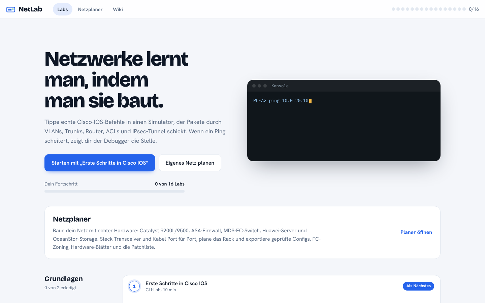
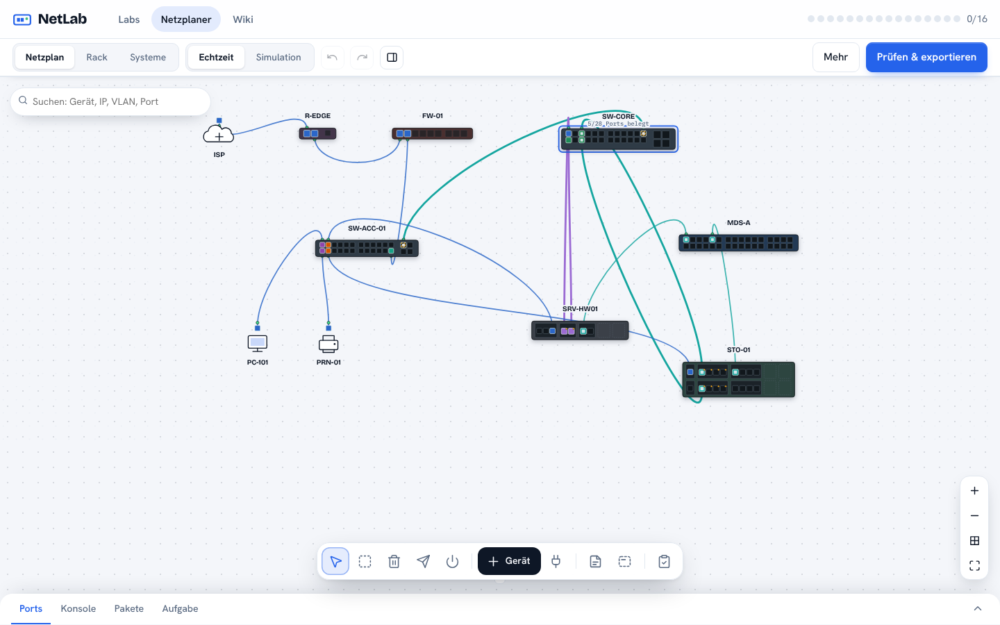
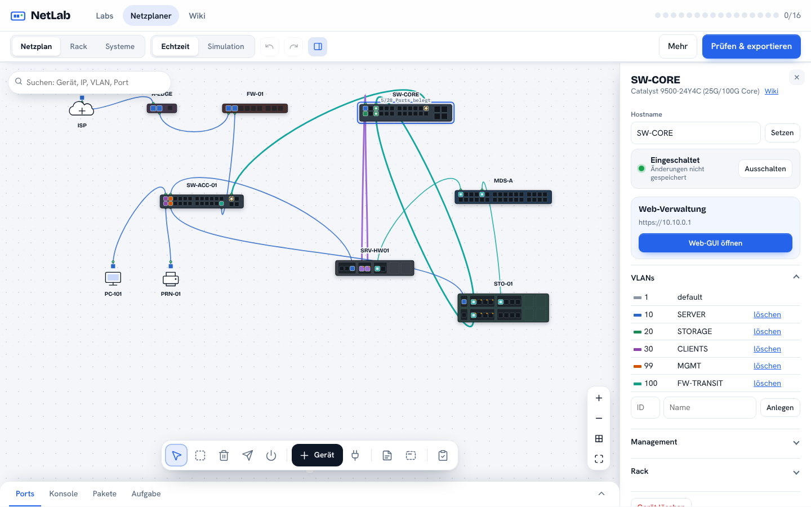
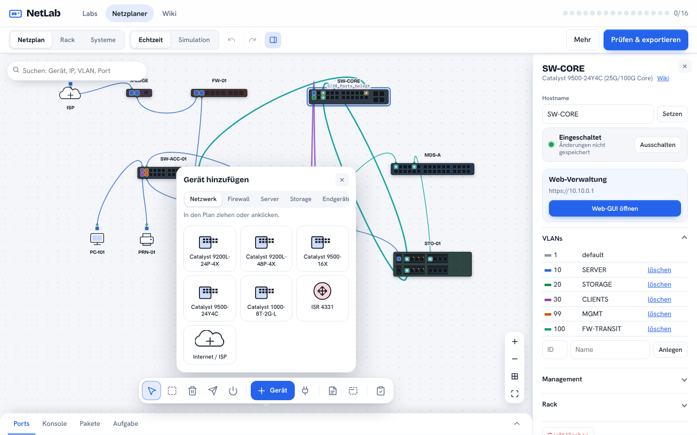
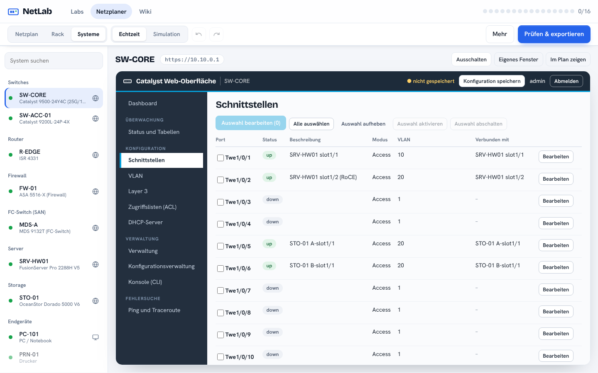
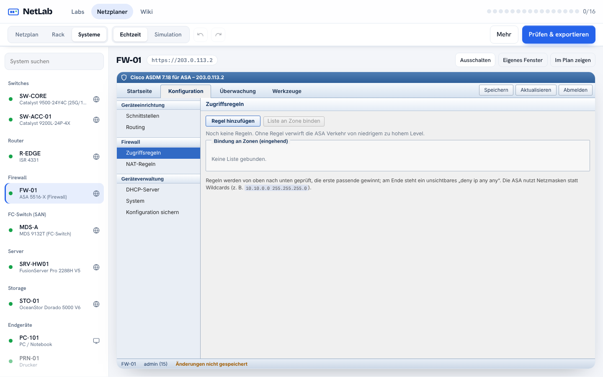
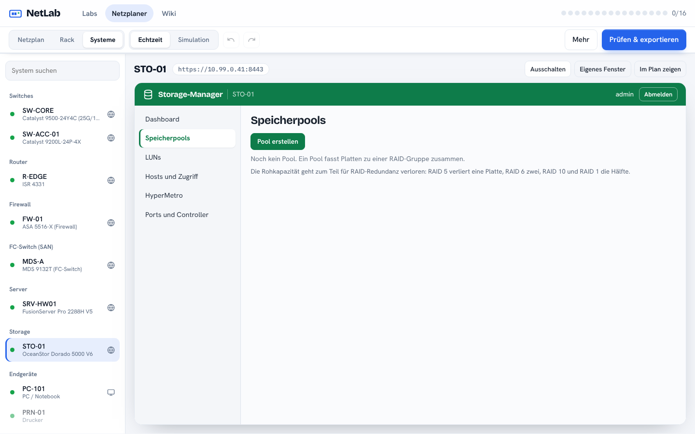
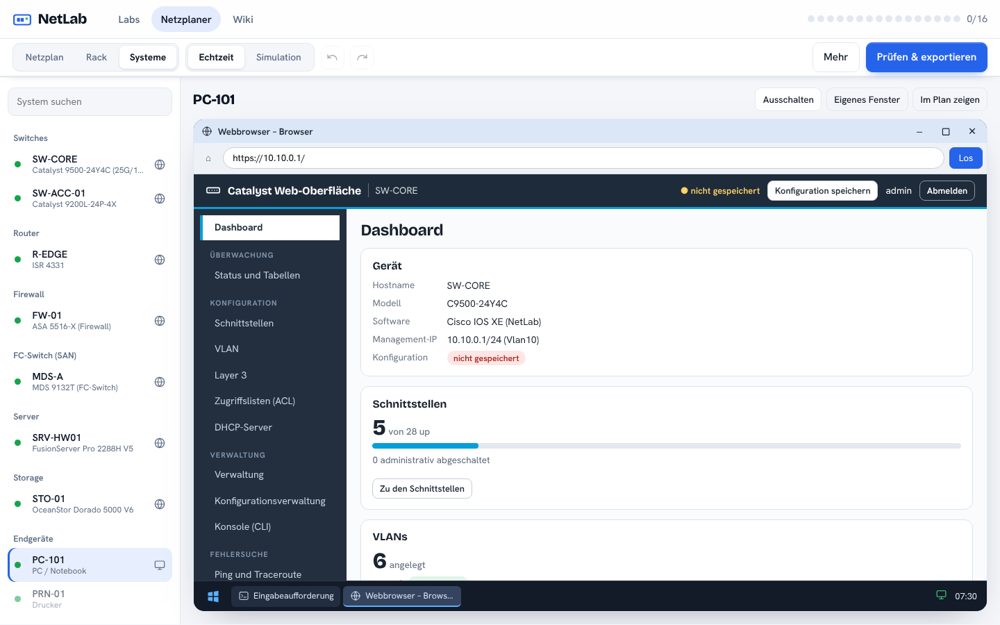
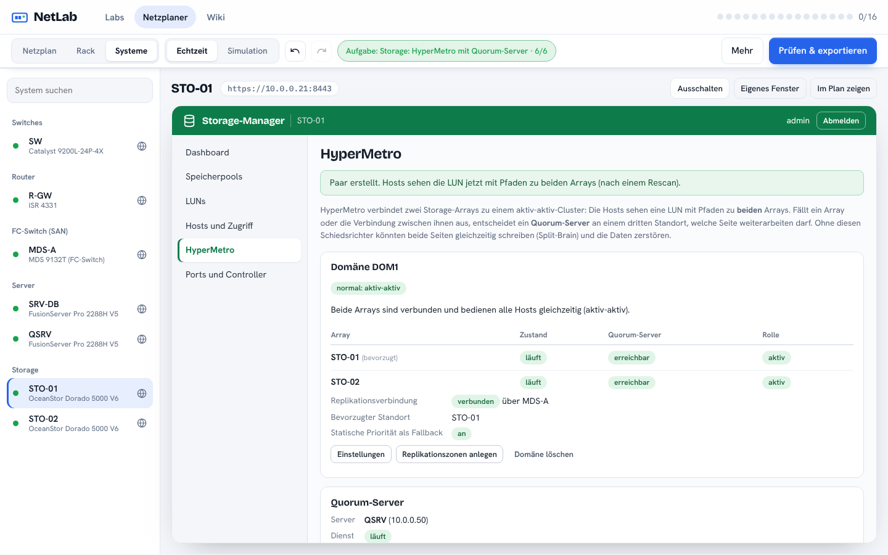
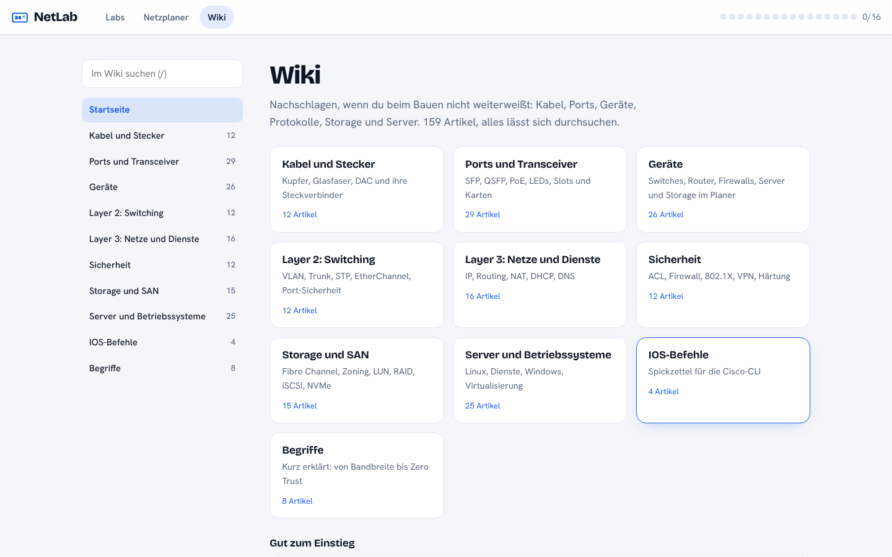

# NetLab – Network Training Platform

Lern- und Planungsplattform für Netzwerk und System Engineering, komplett im Browser (eine einzelne HTML-Datei, kein Backend). Du baust ein Netz aus echter Hardware, konfigurierst es per Terminal oder über die Weboberflächen der Geräte und lässt es von einem Simulator prüfen.

## Auf einen Blick

| | |
|---|---|
|  |  |
| **Start:** 16 Labs mit Fortschrittsanzeige, Netzplaner und Wiki. | **Labs:** CLI-Übungen mit automatischer Bewertung. |
|  |  |
| **Netzplaner:** ruhige Werkbank mit Werkzeugleiste unten, Plan mit Punktraster. | **Details:** erscheinen nur bei Auswahl, mit Port-Ansicht, Strom-Schalter und Web-GUI. |
|  |  |
| **Gerätekatalog:** Catalyst, ISR, ASA, MDS, Server, Storage und Endgeräte nach Kategorie. | **Tab Systeme:** alle Weboberflächen an einem Ort, hier der Catalyst-Switch. |
|  |  |
| **ASA im ASDM-Stil:** Zonen, Zugriffsregeln, NAT, Routing, DHCP. | **Storage-Manager:** Pools, LUNs, Zugriff und Ports. |
|  |  |
| **PC-Desktop:** Fenster, Taskleiste, Browser mit Zugriff auf die Switch-Oberfläche. | **HyperMetro:** zwei Arrays, Quorum-Server und Arbitrierung. |
|  | |
| **Wiki:** 150+ Artikel zu Kabeln, Geräten, Protokollen und Storage. | |

Die Bilder entstehen mit `node scripts/screenshots.js` aus dem gebauten Stand.

## Inhalt

- **Labs (16)** – CLI-Übungen mit automatischer Bewertung: IOS-Grundlagen, Subnetting, VLANs, Trunks, Router-on-a-Stick, statisches Routing, Layer-3-Switch, ACLs, Switch-Härtung, 802.1X/MAB, ISE-Policy, SSL-Inspection, IPsec-VPN (IKEv2), Abschlussprojekt.
- **Netzplaner** – Netz aus echter Hardware bauen (Catalyst, ISR, ASA, MDS-FC, Huawei-Server, OceanStor-Storage), Port für Port verkabeln (Kupfer, Glasfaser, DAC, Transceiver), Rack-Ansicht, Packet-Tracer-artige Palette, Echtzeit- und Simulationsmodus mit Paketanimation.
- **Apps & Dienste** für PCs und Server: IP-Konfiguration (inkl. DHCP), Eingabeaufforderung, Webbrowser, Texteditor; HTTP, DNS, DHCP.
- **Planer-Werkzeuge** – Zoom und Verschieben (Mausrad, Ziehen, Pinch, Tasten `+` `-` `0`), Mehrfachauswahl per Umschalt+Ziehen oder Rahmen-Werkzeug, Ausrichten und Verteilen, Raster, Kopieren/Einfügen/Duplizieren (Strg+C/V/D), Notizen und Zonen, Suche (`/` oder Strg+K), Minimap, Export des Plans als PNG oder SVG.
- **Linux-Server** – Jeder Server hat ein Ubuntu-Terminal mit Dateisystem, `systemctl`, `journalctl`, `apt`, `sudo`, `ufw`, `ip` und Pipes/Umleitungen. nginx, bind9 und isc-dhcp-server steuern die Dienste im Netz (Konfigurationsdateien werden beim Start gelesen). Fünf Szenarien: nginx-Konfigfehler, volle Festplatte, DNS mit bind9, DHCP-Server, ufw blockt Webserver.
- **Wiki** (`#wiki`) – 140+ Artikel zu Kabeln, Steckern, Transceivern, Geräten, Layer 2/3, Sicherheit, Storage, Linux und IOS, mit Suche. Artikel zu jedem Gerätemodell, jeder Karte und jedem Transceiver entstehen automatisch aus den Planer-Daten. Labs und der Planer verlinken passende Artikel.
- **Storage-Labs** – RAID-Pools (RAID 0/1/5/6/10), LUNs (Thick/Thin), LUN-Masking, Zoning auf dem MDS-FC-Switch (ohne aktives Zoneset gilt deny) und SAN am Linux-Server (`lsblk`, `rescan-scsi-bus.sh`, `multipath -ll`, `mkfs`, `mount`). Vier Szenarien: LUN einrichten, Server sieht LUN nicht, RAID dimensionieren, fehlende Pfade.
- **Windows Server und Active Directory** – Server lassen sich auf Windows Server 2022 umstellen (PowerShell-Terminal), Windows-PCs haben ein eigenes Terminal. Rollen (AD DS, DNS, DHCP, IIS, Dateiserver), Domäne mit Benutzern, Gruppen und OUs, Domänenbeitritt, DHCP-Autorisierung, Windows-Firewall und SMB-Freigaben. Fünf Szenarien.
- **Virtualisierung** – Server als Hypervisor einrichten (vSwitch mit Uplinks, VLAN pro VM), VMs mit vCPU/RAM/Platte, Start/Stopp, Kapazitätsprüfung, Cluster, Migration (kalt und live über SAN-Datastore) und HA. VMs sind echte Netzteilnehmer mit Linux- oder Windows-Terminal; `virsh` auf dem Host. Vier Szenarien.
- **Web-GUI für Cisco-Switches und -Router** – Catalyst-ähnliche Oberfläche mit Dashboard und Portansicht, Schnittstellen (Mehrfachauswahl), VLAN, Layer 3 (SVI, Routing, statische Routen), ACL, Konfiguration speichern, CLI-Konsole sowie Ping und Traceroute. Alles läuft über IOS-Befehle des Simulators. Aufruf per Button am Gerät oder vom PC-Browser unter `https://<Management-IP>/`.
- **Cisco-ASDM-Oberfläche für die ASA** – Startseite, Konfiguration, Überwachung und Werkzeuge wie im echten ASDM: Zonen mit Security-Level, Zugriffsregeln, NAT, Routen, DHCP-Server. Läuft über ASA-Befehle des Simulators, Aufruf unter `https://<IP>/`.
- **Netzplaner-Layout** – ruhige Werkbank: Werkzeugleiste unten, Details nur bei Auswahl, Konsole und Ports eingeklappt. Der Tab **Systeme** zeigt alle Weboberflächen und PC-Desktops an einem Ort mit Geräteliste.
- **Ein- und Ausschalten mit Bootvorgang** – Geräte lassen sich ausschalten und starten dann mit Bootzeit. Cisco-Geräte laden danach nur die Startup-Config: ungespeicherte Änderungen gehen verloren.
- **PC-Desktop** – Doppelklick auf einen PC öffnet einen Windows-ähnlichen Desktop (verschiebbares Fenster, Taskleiste, Startmenü) mit Eingabeaufforderung, Webbrowser, Netzwerkverbindungen, Datei-Explorer, Editor und Einstellungen.
- **Web-GUIs der Geräte** – Server, Hypervisor, Windows-Server, Storage und FC-Switch haben eine Weboberfläche mit Anmeldung, Menü, Tabellen und Dialogen (Linux: Dienste, Dateien, Speicher, Firewall; Hypervisor: VMs, vSwitch, Datastores, Cluster; Windows: Rollen, Active Directory, DNS, DHCP, Freigaben; Storage: Pools, LUNs, Zuordnung; Fabric: Zoning). Aufruf über „Web-GUI öffnen“ am Gerät oder per Webbrowser eines PCs unter `https://<IP>:8443`. Jede Aktion zeigt den gleichwertigen Terminal-Befehl.
- **DHCP überall** – Server (Linux, Windows), Cisco-Router und Layer-3-Switches (`ip dhcp pool`, Ausschlüsse) und die ASA (`dhcpd`) vergeben Adressen. Mit `ip helper-address` leitet ein Relay Anfragen an einen Server in einem anderen Netz weiter. Einrichtung in den Weboberflächen oder per CLI, Kontrolle mit `show ip dhcp binding`.
- **HyperMetro** – Zwei Storage-Arrays bilden eine aktiv-aktiv-Domäne mit gespiegelten LUN-Paaren. Ein Quorum-Server (Linux-Paket `quorum-server`) entscheidet bei Ausfällen, welche Seite weiterarbeitet; Replikationsverbindung über FC-Zonen, statische Priorität als Fallback. Der Host sieht ein Gerät mit Pfaden zu beiden Arrays. Zwei Szenarien.
- **Aufgaben** – Aufbau- und Fehlersuche-Szenarien mit live abgehakten Zielen.
- **Ausfall-Simulation** (Gerät ausschalten, Kabel ziehen), Rückgängig/Wiederholen.
- **Export** – Gerätekonfigurationen (IOS/IOS-XE, ASA, MDS-Zoning), Hardware-Blätter für Server/Storage, Patchliste (CSV).

## Aufbau

```
src/engine.js    Simulationskern: L2/L3, VLAN, Trunks, ACL, NAT, IPsec, Firewall, Hardware-Physik, CLI
src/labs.js      Lab-Definitionen, Aufgaben und Musterlösungen
src/wiki.js      Wiki-Artikel und Suche
src/webgui.js    Weboberflächen der Geräte (Linux, Hypervisor, Windows, Storage, FC, Cisco-Switch/-Router, ASDM)
src/desktop.js   Windows-ähnlicher Desktop für PCs
src/virt.js      Hypervisor, vSwitch, VMs, Migration, HA
src/windows.js   Windows-Terminal (PowerShell-Teilmenge, AD, Rollen)
src/storage.js   Pools, LUNs, Masking, Zoning, FC-Pfade
src/linux.js     Linux-Terminal der Server (Dateisystem, systemd, apt, ufw)
src/sandbox.js   Netzplaner (UI), Apps/Dienste, Aufgaben-Szenarien, Lint und Export
src/app.js       Startseite, Lab-Ansicht, Routing
src/shell.html   HTML-Gerüst und Styles
build.py         fügt src/ zu dist/netlab.html zusammen
tests/           Node-Tests für Labs, Apps, Szenarien, Planer, Linux, Storage, SAN, HyperMetro, Windows, Virtualisierung, DHCP und Web-GUIs
scripts/         screenshots.js erzeugt die Bilder für diese README
docs/screenshots Screenshots der Oberfläche
dist/netlab.html fertig gebaute Version (direkt im Browser öffnen)
```

## Entwickeln

```bash
npm run build   # erzeugt dist/netlab.html
npm test        # alle Tests; bei Szenarien muss die Musterlösung alle Ziele erfüllen
node scripts/screenshots.js   # Screenshots neu erzeugen (braucht playwright-core und Chromium)
```

Voraussetzungen: Node.js und Python 3. Die gebaute Datei lädt nur Schriftarten von Google Fonts und JSZip (für den ZIP-Export) von cdnjs; alles andere läuft lokal. Fortschritt und Projekte speichert der Browser per `localStorage`.

## Mit Docker starten

```bash
docker compose up -d --build   # baut das Image und startet NetLab
```

Danach läuft NetLab unter <http://localhost:8080>. Stoppen mit `docker compose down`. Ohne Compose: `docker build -t netlab . && docker run -d -p 8080:80 netlab`. Der Port lässt sich in `docker-compose.yml` ändern.

## Hinweise

Der Simulator bildet Cisco IOS/IOS-XE und ASA vereinfacht nach. Slot-Zahlen und Standardbestückung der Huawei-Geräte sind Planungsannahmen – vor einer Bestellung mit dem Datenblatt abgleichen. Exportierte Konfigurationen sind Vorlagen: Passwörter, Keys, Interface-Namen und WWPNs vor dem Rollout prüfen.
